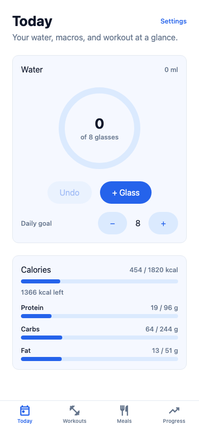
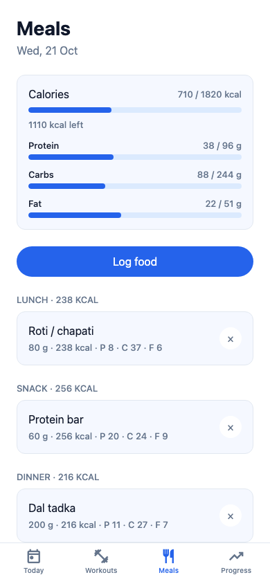
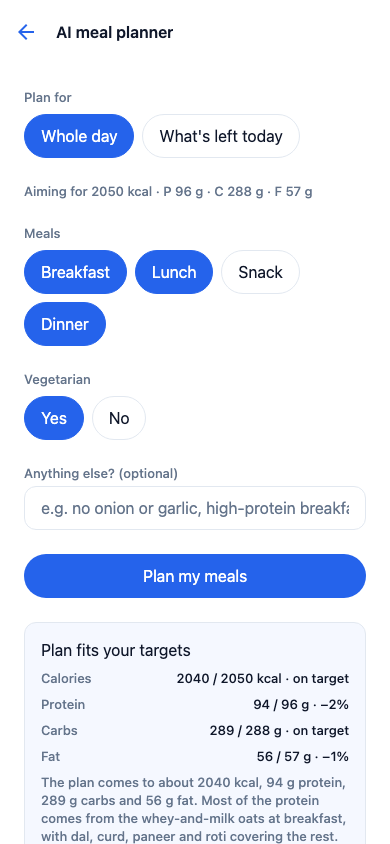
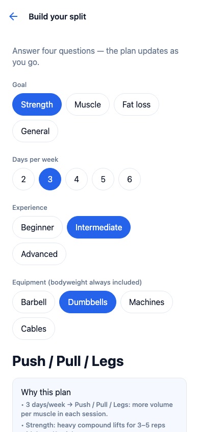
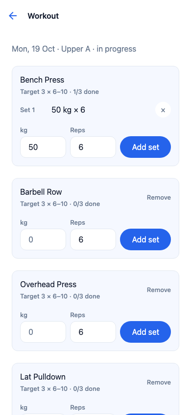
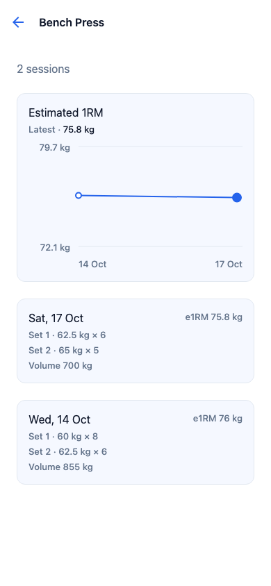
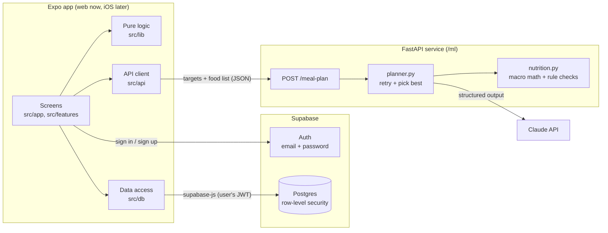

# FitFreak

A minimalist fitness app for vegetarian, Indian-friendly training and nutrition: weekly
split generator, workout logger, macro and water tracking, and an AI meal planner that
hits macro targets — with an ML layer on the way.

Built with Expo (React Native + TypeScript) so the same code runs on the web today and
ships to iOS later, plus a Python FastAPI service for AI and ML.

| Today | Meals | AI meal planner |
|---|---|---|
|  |  |  |

| Split builder | Workout | Lift history |
|---|---|---|
|  |  |  |

## Features

- **Split generator** — rule-based weekly plan from goal, days per week, experience, and
  equipment, with a "why this plan" explanation; every day and exercise is editable.
- **Workout logger** — sets, reps, and weight per exercise; prefills from your last
  session; targets from your split ("3 × 6–10 · 1/3 done"); estimated 1RM history chart.
- **Macro tracker** — targets calculated from body stats (Mifflin-St Jeor, shown step by
  step) or entered by hand; 47 built-in foods with Indian portions (roti, katori); custom
  foods from nutrition labels.
- **AI meal planner** — Claude picks real foods and portions for your remaining macros;
  the server computes and checks every number before the app shows it.
- **Water tracker** — one-tap glass logging toward a daily goal.
- **Metric or imperial** — kg/cm or lb/ft-in everywhere you type or read a measurement.
- **Accounts** — email sign-up and log-in; your data follows you to any browser. Data
  logged before accounts existed can be imported once from Settings.

## Architecture

A high-level view is below. The full set of diagrams is in **[docs/architecture.md](docs/architecture.md)**: sign-in flow, a request traced end to end, the data model, the import, and testing.



The code is organised in layers, and each layer only talks to the one beneath it:

| Layer | Where | Rule |
|---|---|---|
| Screens | `src/app/` (one file per route, Expo Router) | Layout and wiring only |
| Feature components | `src/features/<feature>/` | UI for one feature, plus its hooks |
| Shared components | `src/components/` | Generic UI; all styling from `src/theme.ts` |
| Pure logic | `src/lib/` | No storage, no UI, no network — unit-testable math and validation |
| Data access | `src/db/` | Every query lives here; functions take the Supabase client so tests can swap in a local one |
| Database | `supabase/migrations/` | Schema, row-level security, and multi-step operations as SQL functions; append-only |
| Backend | `ml/app/` | FastAPI; holds the Anthropic key; never trusted blindly by the app |

### Design decisions

- **AI chooses, code computes.** For meal plans, Claude only picks food ids, grams, dish
  names, and instructions — constrained to a JSON schema. The server calculates every
  macro from the app's own food data, rejects unknown foods, non-veg items in vegetarian
  plans, and absurd portions, and gives Claude one correction round with the real
  numbers. The app validates the response again before display. Nutrition numbers never
  come from the model.
- **Deterministic logic is separate from AI.** Split generation, target calculation, and
  macro math are plain functions in `src/lib/` with exhaustive tests (e.g. all 960 split
  input combinations are checked against the rules).
- **Storage is metric; units are a display concern.** Converting only at the input/output
  boundary means switching units never rewrites history.
- **History is immutable.** Food logs copy their macros at log time; workouts copy their
  split targets when started. Editing a food or a split never changes past days.
- **Security lives in the database.** The app ships a public key, so the database itself
  enforces who sees what: every table has row-level security, child rows (sets, split days)
  also check that their parent belongs to the caller, and built-in foods can't be forged.
  `npm run test:db` attacks it with a second account and a logged-out visitor.
- **Multi-step writes are SQL functions.** Starting a workout from a split day, saving a
  split, or deleting and renumbering a set each run as one transaction on the server
  instead of several requests that could half-finish.
- **Migrations, not resets.** Both the cloud schema and the old local SQLite schema evolve
  through append-only migrations, tested against databases with real data in them.
- **Model training data from day one.** Every set, glass, and food entry is stored as an
  individual timestamped event, and workouts record their targets — the raw material for
  the progressive-overload model.

## Getting started

Requirements: Node 20+, a free [Supabase](https://supabase.com) project,
[uv](https://docs.astral.sh/uv/) (Python) and an Anthropic API key for the meal planner.

1. In Supabase, open **SQL Editor** and run the files in `supabase/migrations/` in order.
2. Under **Authentication → URL Configuration**, set the Site URL to where the app runs
   (`http://localhost:8081` for development) so confirmation and reset emails link back.
3. Then:

```bash
npm install
cp .env.example .env.local      # Project URL + publishable key (Project Settings → API)
npx expo start --web            # app at http://localhost:8081

cp ml/.env.example ml/.env      # add your ANTHROPIC_API_KEY
npm run api                     # backend at http://localhost:8000
```

The app works without the backend; only the AI meal planner needs it.

## Tests

```bash
npm test          # app logic + database tests (Node's built-in runner and SQLite)
npm run test:api  # backend tests (pytest, fake Claude client — no key or cost)
npm run test:db   # applies supabase/migrations to a throwaway local Postgres, checks
                  # row-level security with two users, then runs the real src/db code
                  # against it through PostgREST (needs: brew install postgresql postgrest)
npm run typecheck
npx expo lint
```

## Repository layout

```
src/
  app/          routes (tabs: Today, Workouts, Meals, Progress; plus pushed screens)
  features/     water, workouts, split, macros, mealPlan, settings
  components/   shared UI (Screen, Card, Button, OptionGroup, LineChart, ProgressRing…)
  lib/          pure logic: macros, split rules, workout math, units, meal-plan validation, auth
  db/           queries against Supabase; seed exercises and foods; local/ reads the
                pre-account SQLite database for the one-time import
  api/          HTTP client for the backend
  theme.ts      colors, spacing, type scale — the only place styles are defined
ml/
  app/          FastAPI app; meal_plan/ (schemas, prompt, planner, nutrition)
  tests/        pytest suite
supabase/
  migrations/   cloud schema, row-level security, RPC functions, built-in reference data
scripts/        reference-data SQL generator, local database test runner
tests/          app tests (node --test); tests/db (SQL) and tests/cloud (data layer) for the database
docs/           screenshots
```

## Roadmap

- [x] Phases 1–6 — scaffold, water, workouts, split generator, macros, AI meal planner
- [x] Accounts and cloud data (Supabase auth + Postgres with row-level security)
- [ ] Hosted website for friends; AI planner limited per user per day
- [ ] Front-end overhaul — desktop layout, dashboard with weekly charts, onboarding, dark mode
- [ ] ML: synthetic training data → progressive-overload predictor (linear baseline vs
      gradient boosting, time-based split) → LP meal optimiser → SHAP explanations in the app
- [ ] iOS build with EAS

## Notes on data

Built-in food values are compiled from USDA FoodData Central, the Indian Food Composition
Tables (IFCT 2017), and typical home recipes for mixed dishes. They're rounded
approximations — add a custom food from the label when precision matters.

## License

[MIT](LICENSE)
