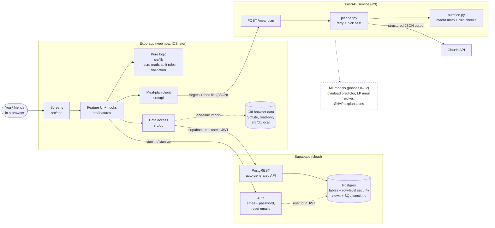
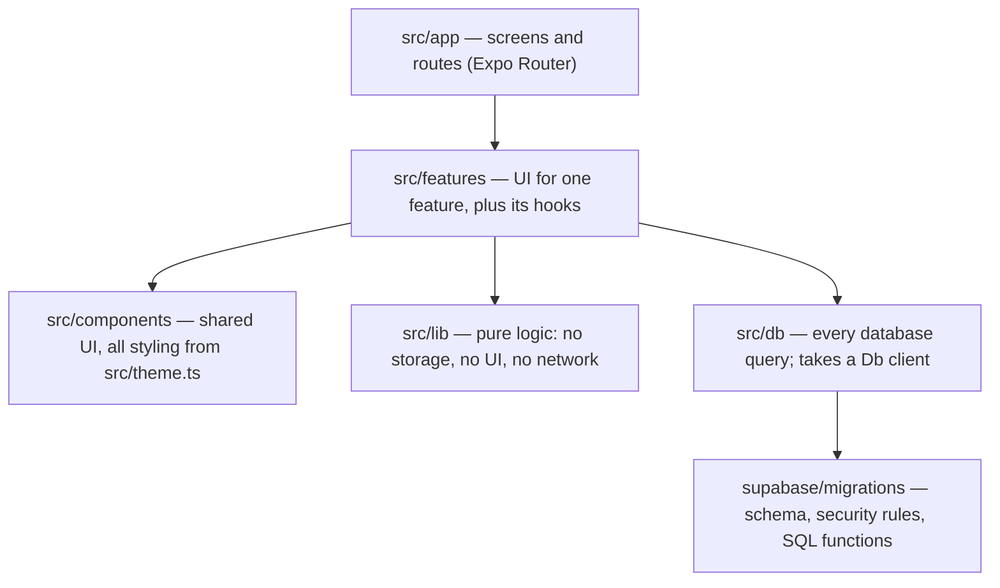
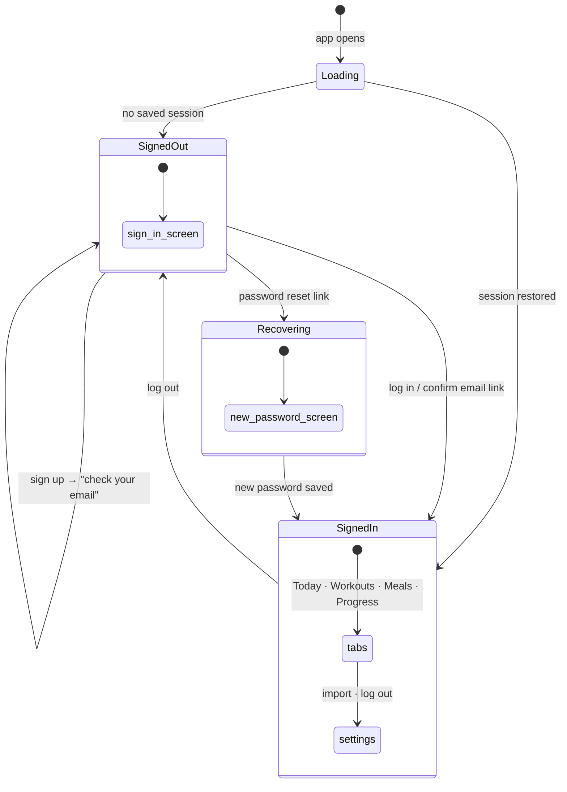
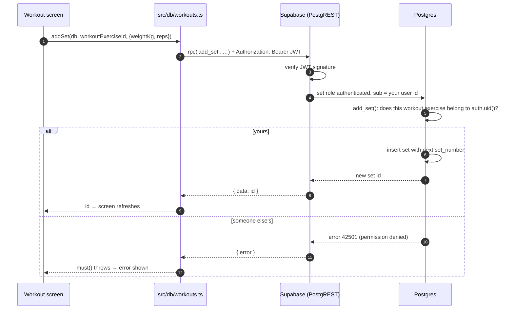
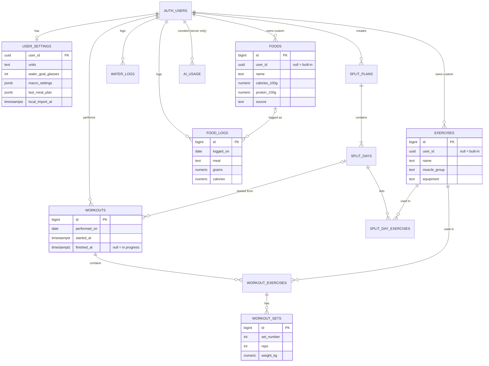
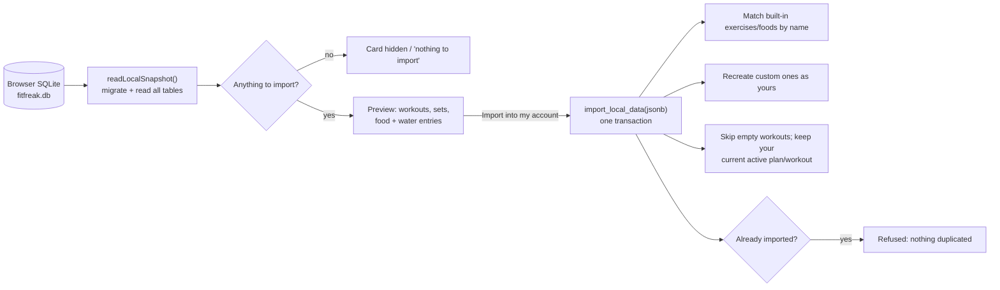
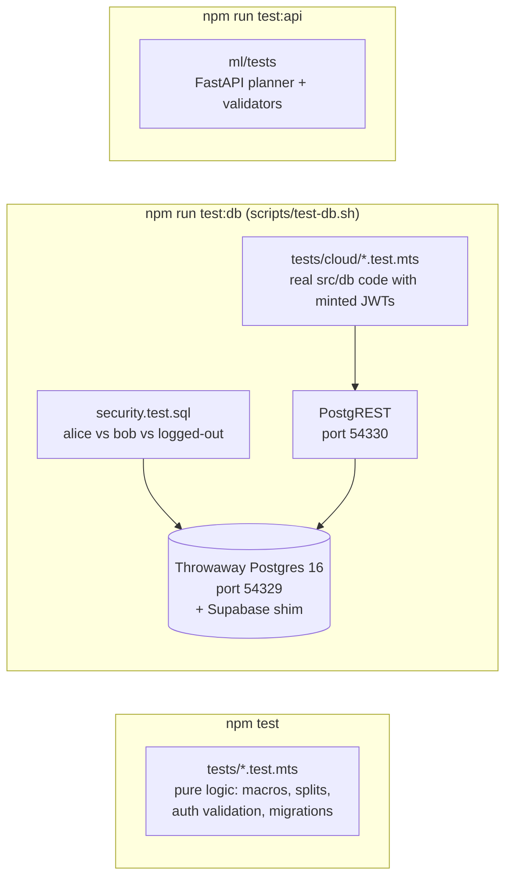
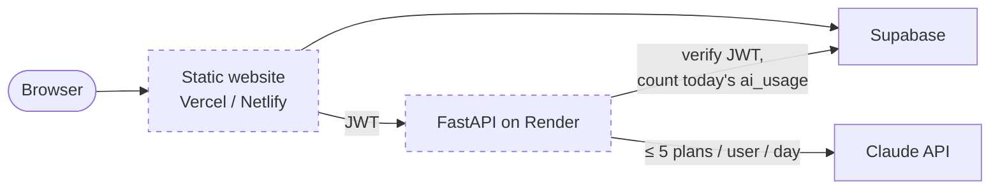

# FitFreak architecture

How the pieces fit together. The diagrams are [Mermaid](https://mermaid.js.org/), which GitHub renders in place.
Dashed boxes are planned and not built yet.

## 1. System overview

**Where secrets live.** The app only holds the Supabase URL and *publishable* key. Both are public on purpose, because privacy is enforced inside Postgres (section 4).
The Anthropic key exists only on the FastAPI server, in `ml/.env`.

## 2. Code layers

Each layer only calls the one beneath it, so the logic can be tested without a UI or a network.

## 3. Signing in and route guards

`AuthProvider` tracks the session. `src/app/_layout.tsx` uses `Stack.Protected`, so each state can only reach its own screens.

## 4. One request, end to end: adding a set

**Row-level security** means every table carries a rule like `user_id = auth.uid()`. The database checks it on every read and write, whatever the request came from.
Built-in exercises and foods have `user_id = null`. Everyone can read them, and nobody can change them.

## 5. Data model

Every user-owned table also has `user_id → auth.users`. Deleting an account cascades to all of that user's rows.

Read-only **views** for the Progress screens: `workout_summaries`, `exercise_sets`, `last_sets`, `logged_exercises`. They are `security_invoker`, so they follow the same row-level security.

**SQL functions** handle the writes that touch several rows:
- `start_workout`, `start_workout_from_split_day`, `finish_workout`
- `add_exercise_to_workout`, `add_set`, `delete_set`
- `save_split`, `add_split_day`, `add_exercise_to_split_day`, `move_split_exercise`
- `import_local_data`

## 6. Importing pre-account browser data

## 7. How it's tested

## 8. Planned: hosting and the AI limit

